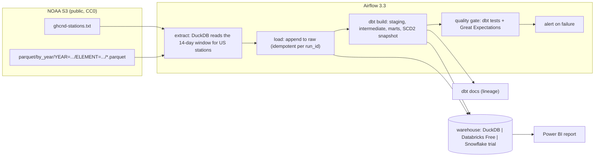

# elt-modern-data-stack

Daily ELT over NOAA's GHCN-Daily weather observations for every US station. Airflow extracts each day's lookback window from NOAA's public Parquet bucket with DuckDB, loads it into an append-only raw layer, and dbt builds staging, intermediate and mart models with tests, an incremental station-day fact and a slowly changing (SCD Type 2) station dimension. Data-quality failures alert, lineage is published as a dbt docs site, and a Power BI report reads the Florida marts. It runs for free on DuckDB locally and in CI, and against Databricks Free Edition hosted.

Status: milestone 1 of 7 (local extract and load). The results section is filled in by committed scripts as milestones land; nothing in it is typed by hand.

## Architecture



## Quick start (local, free)

Requirements: Python 3.12 via [uv](https://docs.astral.sh/uv/), about 1 GB of disk for a year of US data.

```bash
uv sync --all-extras
cp .env.example .env            # defaults are fine
uv run ghcn-elt measure         # rows the next run would process, no writes
uv run ghcn-elt run             # extract today's 14-day window, load it, snapshot stations
```

`data/warehouse.duckdb` now holds `raw.ghcn_observations` and `raw.ghcn_stations`; `data/metrics/extract_runs.jsonl` holds one line per run.

Backfill a range (each day re-reads its own 14-day window, so reruns are safe):

```bash
for d in 2026-10-01 2026-10-02; do uv run ghcn-elt run --run-date "$d"; done
```

## Tests

```bash
uv run pytest --cov            # unit tests, offline (fixture under tests/fixtures/)
uv run pytest -m network       # integration test against NOAA's bucket
```

## Data and license

GHCN-Daily (Menne, M.J., I. Durre, R.S. Vose, B.E. Gleason, and T.G. Houston, 2012: An overview of the Global Historical Climatology Network-Daily database. J. Atmos. Oceanic Technol., 29, 897-910) is published by NOAA NCEI and mirrored on the AWS Open Data registry (`s3://noaa-ghcn-pds`) under the CC0 1.0 Universal Public Domain Dedication. Code in this repository is MIT licensed.

## Results

Filled in by `scripts/report_runs.py` from `data/metrics/extract_runs.jsonl` and dbt's `run_results.json`. Measured on the machine stated with each number.

## Known limitations

- Station scope is a prefix filter on the GHCN id (`US` by default); territories whose ids start with other codes are excluded.
- NOAA revises recent days; the 14-day lookback covers the common case, not every late revision.
