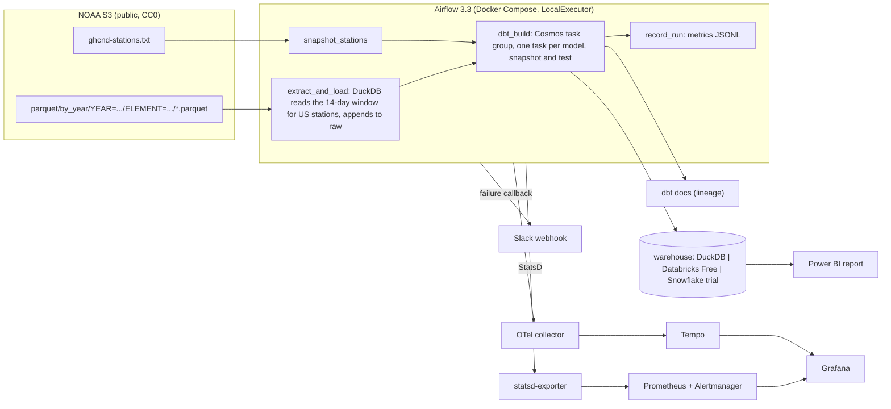

# elt-modern-data-stack

Daily ELT over NOAA's GHCN-Daily weather observations for every US station. Airflow extracts each day's lookback window from NOAA's public Parquet bucket with DuckDB, loads it into an append-only raw layer, and dbt builds staging, intermediate and mart models with tests, an incremental station-day fact and a slowly changing (SCD Type 2) station dimension. Data-quality failures alert, lineage is published as a dbt docs site, and a Power BI report reads the Florida marts. It runs for free on DuckDB locally and in CI, and against Databricks Free Edition hosted.

Status (2026-10-17): milestones 1 to 4 of 7 done locally (extract and load, dbt project, Airflow with observability, CI). Hosted warehouse targets, the VM deployment and the Power BI report are next. The results section is produced by committed scripts; nothing in it is typed by hand.

## Architecture



## Quick start (local, free)

Requirements: Python 3.12 via [uv](https://docs.astral.sh/uv/); Docker for the Airflow stack.

```bash
uv sync --all-extras
cp .env.example .env            # fill the AIRFLOW_* secrets before using compose
uv run ghcn-elt measure         # rows the next run would process, no writes
uv run ghcn-elt run             # extract today's 14-day window, load it, snapshot stations
cd dbt && DBT_PROFILES_DIR=. uv run dbt build && cd ..   # staging, marts, snapshot, 43 tests
```

`data/warehouse.duckdb` now holds `raw.*` and `main_marts.*`; `data/metrics/extract_runs.jsonl` holds one line per run.

Backfill a range (each day re-reads its own 14-day window, so reruns are safe):

```bash
for d in 2026-10-01 2026-10-02; do uv run ghcn-elt run --run-date "$d"; done
```

### Airflow

```bash
make airflow-build              # image: Airflow 3.3.2 + the extractor + dbt in its own venv
make airflow-up                 # Postgres, api-server (http://localhost:8080), scheduler, dag-processor, triggerer
make airflow-e2e                # trigger ghcn_daily over the API and wait for the scheduler to run it end to end
make airflow-up-all             # adds Prometheus :9090, Alertmanager :9093, Grafana :3000 (dashboard "GHCN ELT pipeline"), OTel collector, Tempo
make airflow-down
```

Without `make` (Windows), the commands are the `docker compose -f airflow/docker-compose.yml --env-file .env ...` lines in the Makefile. The DAG `ghcn_daily` runs at 07:00 UTC; the dbt models appear as `dbt_build.<model>.run` / `.test` tasks. Logging in uses `AIRFLOW_ADMIN_USER` / `AIRFLOW_ADMIN_PASSWORD` from `.env`.

## Tests

| Layer | Command | What it covers |
|---|---|---|
| Unit | `uv run pytest --cov` | window and partition maths, fixed-width station parsing, SQL shape, loader idempotency and rollback, CLI end to end against a local copy of NOAA's layout, metrics, config |
| dbt integration | included in `pytest` (marked `slow`) | builds the dbt project twice on a DuckDB file loaded from the committed fixture: all 52 nodes pass, second build leaves the marts identical, staging collapses overlapping runs, the snapshot opens a new version when a station is renamed |
| Live source | `uv run pytest -m network` | two-day read for Florida CoCoRaHS stations from the real bucket, extract and load |
| Alerts | `make alerts-test` | `promtool check rules` and unit tests that make each alert fire (task failure, tiny load, scheduler heartbeat lost) |
| DAG | `make dag-tests` | DAG imports with no errors, task shape, retries and callbacks, DuckDB pool assignment, failure message formatting (runs inside the image) |
| End to end | `make airflow-e2e` | one real DAG run through the scheduler and executor: NOAA to raw to 17 Cosmos tasks to metrics |

CI (`.github/workflows/ci.yml`) runs lint, format check, mypy, the unit and dbt suites with coverage, the live read, gitleaks, the alert tests, and builds the image to run the DAG tests and the end-to-end run. Dependabot watches pip, GitHub Actions and the Docker base images.

## Observability

- Metrics: Airflow StatsD to a statsd-exporter (mapping in `airflow/observability/statsd_mapping.yml`), scraped by Prometheus. Custom gauges from the DAG: `ghcn_rows_extracted`, `ghcn_rows_loaded`, `ghcn_extract_seconds`.
- Traces: the extractor emits OpenTelemetry spans (`ghcn.extract`, `ghcn.load`, `ghcn.stations`, with row counts and byte sizes as attributes) over OTLP/HTTP to a collector and Grafana Tempo. Airflow's own tracer is left off; `docs/decisions/0004` records why.
- Dashboard: Grafana "GHCN ELT pipeline" (rows loaded, hours since last success, task failures, run and task durations).
- Alerts (`airflow/observability/alert_rules.yml`): no successful run in 26 hours, a task failed, rows loaded under 50K, scheduler heartbeat missing. Each has a promtool unit test. Alertmanager routes to Slack when `SLACK_WEBHOOK_URL` is set; the DAG also posts task failures directly.
- Logs: structured JSON from the extractor (structlog); Airflow task logs in the UI.

## Data and license

GHCN-Daily (Menne, M.J., I. Durre, R.S. Vose, B.E. Gleason, and T.G. Houston, 2012: An overview of the Global Historical Climatology Network-Daily database. J. Atmos. Oceanic Technol., 29, 897-910) is published by NOAA NCEI and mirrored on the AWS Open Data registry (`s3://noaa-ghcn-pds`) under the CC0 1.0 Universal Public Domain Dedication. Code in this repository is MIT licensed.

## Results

Produced by `uv run python scripts/report_runs.py --write-readme README.md` from `data/metrics/extract_runs.jsonl` (one line per run, written by the CLI and by the DAG's `record_run` task). Machine: Intel i7 (20 threads), Windows 11, home fibre connection; DuckDB target; "total" is extract + load + station snapshot, dbt excluded.

<!-- results:start -->
Runs recorded: 4 (showing the last 4)

| run date | window | rows extracted | rows loaded | bronze MB | extract s | load s | total s | stations |
|---|---|---:|---:|---:|---:|---:|---:|---:|
| 2026-10-17 | 2026-10-03 to 2026-10-17 | 659,929 | 659,929 | 1.9 | 1.8 | 0.2 | 9.9 | 78568 |
| 2026-10-17 | 2026-10-03 to 2026-10-17 | 659,929 | 659,929 | 1.9 | 1.9 | 0.3 | 5.3 | 78568 |
| 2026-10-17 | 2026-10-03 to 2026-10-17 | 659,929 | 659,929 | 1.9 | 2.0 | 0.9 | 3.0 | 78568 |
| 2026-10-17 | 2026-10-03 to 2026-10-17 | 659,929 | 659,929 | 1.9 | 2.0 | 0.9 | 2.9 | 78568 |

Median rows processed per run: **659,929**. Median extract time: **1.9 s**. Median end-to-end (extract + load + stations): **4.1 s**.
<!-- results:end -->

End-to-end through Airflow (scheduler + LocalExecutor + Cosmos, DuckDB single-writer pool), measured by `scripts/e2e_airflow_run.py` on 2026-10-17: **19 of 19 tasks succeeded in 80 seconds** (extract_and_load 3.9 s, snapshot_stations 3.2 s, 17 dbt tasks at about 3 s each, record_run 0.6 s).

dbt on the same warehouse (2026-10-17, 659,929 raw rows, 232,116 station-days): `dbt build` runs 52 nodes (3 views, 1 incremental, 1 snapshot, 4 tables, 43 tests) in about 2 seconds in-process. Under Airflow with Cosmos the same build is 17 sequential tasks (see `docs/decisions/0004`).

## Known limitations

- Station scope is a prefix filter on the GHCN id (`US` by default); territories whose ids start with other codes are excluded.
- NOAA revises recent days; the 14-day lookback covers the common case, not every late revision.
- Raw grows by about 15x the daily increment (each day is re-read on 15 runs); a retention job is a planned follow-up.
- The simple auth manager stores the admin password in a local file; the VM deployment adds TLS and rate limiting in front, and a hashed-password auth manager is on the list before anyone but me logs in.

## Decisions

`docs/decisions/`: dataset choice, DuckDB-first with hosted targets, lookback window and append-only raw, Airflow with Cosmos and a single-writer pool.
