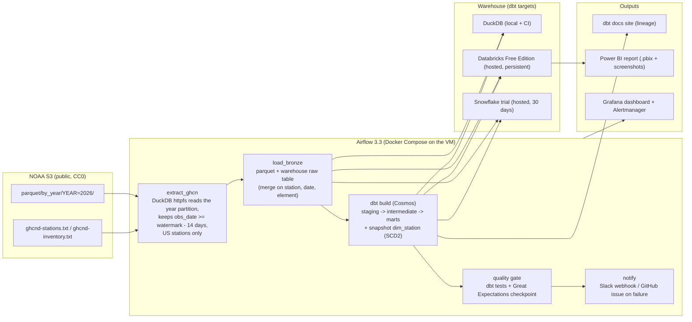

# P1 plan: elt-modern-data-stack

Status: plan for approval, 2026-10-17. No code yet. The repository folder exists only to hold this file.

## Goal

A daily ELT pipeline over NOAA's GHCN-Daily weather observations for all US stations: Airflow extracts the day's data from NOAA's public S3 bucket, dbt builds staging, intermediate and mart models with tests, a slowly changing station dimension and incremental facts, data-quality failures alert, lineage is published, and a Power BI report reads the Florida marts. It runs for free on DuckDB locally and in CI, and against Databricks Free Edition (and a Snowflake trial) hosted.

## Dataset and license

**NOAA Global Historical Climatology Network Daily (GHCN-Daily)**, the standard daily land-surface observation dataset (temperature max/min, precipitation, snow, and more, per station per day).

- License: NOAA data on the AWS Open Data registry is published under the Creative Commons CC0 1.0 Universal Public Domain Dedication, "no restrictions on the use of the data". NOAA asks for a citation (Menne et al., 2012), which the README will carry.
- Source: S3 bucket `noaa-ghcn-pds` (us-east-1, anonymous HTTPS access, no AWS account needed). Verified 2026-10-17:
  - `parquet/by_year/YEAR=2026/` Hive-partitioned Parquet, rewritten daily (the 2026 CSV twin is 116 MB gzipped as of 2026-10-17 00:03 UTC).
  - `ghcnd-stations.txt` (11.4 MB, station metadata, updated 2026-10-15) and `ghcnd-inventory.txt` (36 MB, per-station element coverage).
  - `ghcnd-version.txt` updated 2026-10-17 00:02 UTC: the bucket updates every night.
- Scope: stations whose id starts with `US` (configurable). Backfill from 2024-01-01 to present, then one run per day. Expected volume: tens of thousands of observation rows per US day (the exact figure is measured in milestone 1 and goes into the README, not guessed).
- Why this and not the alternatives in the brief: FAA/BTS on-time data is monthly, not daily; the City of Tampa portal is small (27 datasets) and its license text was not findable; Florida tourism data has no open API. GHCN updates nightly, is public domain, is large enough to need incremental logic, and has a station dimension whose attributes change (the SCD2 case). A Florida-focused mart keeps the local angle for Tampa Bay recruiters.

## Architecture

Models (dbt):

- `stg_ghcn__observations`: typed rows, units converted (tenths of a degree and millimetre to real numbers), quality flags kept.
- `stg_ghcn__stations`, `stg_ghcn__inventory`.
- `int_observations_pivoted`: one row per station-day with tmax, tmin, prcp, snow, snwd, plus flag counts.
- `fct_station_day` (incremental, merge key station_id + obs_date, 14-day lookback because NOAA revises recent days).
- `dim_station` from a dbt snapshot (check strategy on name, latitude, longitude, elevation, state, network flags, WMO id): SCD Type 2 with valid_from / valid_to / is_current.
- `mart_daily_state_summary`, `mart_florida_weather` (what Power BI reads), `mart_station_coverage`.
- Tests: unique and not-null keys, accepted ranges (tmax between -70 and 60 C, prcp >= 0, tmin <= tmax), relationships to dim_station, source freshness (fails if the newest obs_date is older than 3 days), plus a Great Expectations checkpoint on row-count drift (today's row count within 3x the 30-day median).

## What is already covered by his portfolio and is not rebuilt here

Kafka streaming and event-time ETL (kafka-clickhouse-analytics, streaming-etl-pipeline). This project is batch ELT with a warehouse, dbt and orchestration, which none of the 79 repos has.

## Hosting (decision needed)

Airflow needs an always-on scheduler for the "N days of real runs" number.

| Option | Cost | Notes |
|---|---|---|
| A. Oracle Cloud always-free Ampere A1 VM | $0 | Reports in 2026 say the free quota is now 2 OCPU / 12 GB (was 4 / 24); enough for Airflow with LocalExecutor + Postgres + Grafana. Capacity in popular regions is unreliable; needs his account (card for identity, not charged). Recommended first try. |
| B. Azure for Students B2s VM (2 vCPU, 4 GB) | about $35/month from the $100 credit | Certain to be available; eats a third of the credit per month, and the credit is also wanted for P3. |
| C. No VM: GitHub Actions cron runs the same tasks daily (`airflow dags test`) | $0 | Keeps the data moving but there is no live Airflow UI to show. Kept as the backstop in every option. |

Recommendation: A, with C as the backstop. Terraform provisions the VM (OCI provider or azurerm, chosen by option) and cloud-init installs Docker and starts the compose stack; Caddy terminates TLS and rate-limits; Airflow's own user auth protects the UI. `make deploy` and `make destroy` wrap `terraform apply` and `terraform destroy`.

## Warehouse (decision needed)

- **Databricks Free Edition** as the persistent hosted target: $0, serverless only, one 2X-Small SQL warehouse, 5 concurrent job tasks, fair-use shutdowns, non-commercial, may be deleted if inactive. Sign-in is email/Google/Microsoft only. Whether personal access tokens are available for dbt and Airflow is not stated in the limitations page; it is the first thing to verify after sign-up (fallback: dbt's OAuth M2M, or run dbt inside a Databricks Job).
- **Snowflake 30-day trial** ($400 of credits, then the account is suspended) as the second target: proves the `dbt-snowflake` profile and a Snowflake cost note during the window, then the project keeps running on Databricks.
- **DuckDB** for local and CI, always.

The dbt project stays adapter-neutral; the incremental merge and snapshot use dbt's built-in strategies, which all three adapters support.

## Cost estimate

$0 if options A and Databricks are used: NOAA data (free), DuckDB (free), Databricks Free Edition (free), Snowflake trial (free for 30 days), Oracle A1 (free), GitHub Actions (private repo: 2,000 minutes a month; CI is about 10 minutes a run), Slack free workspace, Power BI Desktop (free; not installed on this machine yet, installed via winget). Option B costs about $1.20 a day of student credit. I will ask before anything that costs money, including creating the Oracle or Azure resource.

Credits per run will be recorded in the README: Snowflake from `QUERY_HISTORY`, Databricks from the job run duration and DBU rate (Free Edition hides billing tables), DuckDB as wall time.

## Milestones and verification

| # | Milestone | Verify |
|---|---|---|
| M1 | Repo skeleton (uv, ruff, mypy, pytest, pre-commit, MIT, .env.example, gitleaks), DuckDB extract of the current-year partition for US stations, bronze parquet, row and byte counts measured | `make extract` logs rows/run and seconds; `make test` green |
| M2 | dbt project: sources, staging, intermediate, marts, `dim_station` snapshot, incremental fact with 14-day lookback; tests; a backfill script; an idempotency test (run the same day twice, counts unchanged) | `dbt build` on DuckDB passes all tests twice in a row with identical counts |
| M3 | Airflow 3.3 in Compose (LocalExecutor, Postgres), Cosmos-rendered dbt tasks, assets, retries, failure callback to Slack/GitHub, Great Expectations checkpoint, StatsD to Prometheus, Grafana dashboard, Alertmanager rule "no successful run in 26 h" fired by a test | `docker compose up`, `airflow dags test ghcn_daily`, alert test passes |
| M4 | CI/CD: lint, format, mypy, unit + integration (dbt on DuckDB with a fixture day) + e2e (compose Airflow run) with coverage, gitleaks, Dependabot; deploy job on merge to main (ssh to VM, pull, compose up) | all checks green on a PR; coverage report uploaded |
| M5 | Hosted targets: Databricks Free Edition profile and a scheduled run; Snowflake trial profile proven once; cost notes | `dbt build --target databricks` passes; a job run visible in the workspace |
| M6 | Deploy: Terraform VM + cloud-init; public Airflow UI over TLS; daily runs begin; dbt docs published | URL reachable; day 1 of real runs recorded |
| M7 | Power BI report (Florida weather: temperature anomalies, precipitation, station coverage) committed as .pbix with screenshots; README results after 7+ real runs; ADRs; PROJECT-FACTS entry | README numbers generated by `scripts/report_runs.py` from Airflow's database and dbt artifacts |

Estimated effort: 8 to 10 working days of build time, plus the calendar wait for 7 daily runs.

## Definition of done (section 3 of the brief, mapped)

1. Deployed: Airflow UI and dbt docs at public URLs; Terraform + cloud-init; `make deploy` / `make destroy`.
2. CI/CD: ruff, black check, mypy, pytest, dbt tests, gitleaks on every push; deploy on merge to main.
3. Tests: unit (parsers, unit conversions, watermark logic), integration (dbt build and Great Expectations against DuckDB loaded from a committed fixture day; Airflow DAG import and structure tests), e2e (compose Airflow run of the DAG in CI), coverage reported with pytest-cov.
4. Observability: Airflow JSON logs, StatsD metrics to Prometheus, OpenTelemetry traces from the extract task, one Grafana dashboard, one Alertmanager rule that a test fires.
5. Security: Airflow user auth behind Caddy TLS with rate limiting; secrets only in `.env` or the VM's environment; gitleaks in CI; `uv.lock` pins; Dependabot.
6. Config: `.env.example`, Docker Compose, Airflow health endpoint checked by compose, graceful shutdown (compose stop grace period, LocalExecutor drains tasks).
7. Docs: README (summary, Mermaid, quick start, tests, deploy, results with methodology, limitations), `docs/decisions/` with ADRs: dataset choice, DuckDB-first multi-target dbt, 14-day lookback incremental strategy, hosting choice, snapshot-based SCD2.
8. Numbers: rows processed per run and end-to-end runtime (from Airflow's database), data-test pass rate over N real daily runs (from dbt `run_results.json`), each produced by a committed script and labelled "hosted on a 2 OCPU VM" or "local".
9. Data: public domain only.
10. MIT license; NOAA citation.

## Accounts and steps only you can do (I will stop and tell you exactly when)

1. Databricks Free Edition sign-up (email), then create a personal access token if the UI offers one.
2. Snowflake trial sign-up (optional, 30 days).
3. Oracle Cloud account (option A) or using your Azure for Students subscription (option B).
4. A Slack incoming webhook for alerts (optional; GitHub issues are the fallback).
5. Repo creation is done with `gh` as private; making it public and pushing wait for your word.

## Risks

- Docker Desktop's disk image lives on C:, which has 28 GB free; the image is already 32 GB with about 9 GB reclaimable. Airflow, Postgres, Prometheus and Grafana images add a few GB. Pruning or moving the Docker disk to G: should happen before milestone 3; I will ask before doing either.
- Databricks Free Edition fair-use shutdowns could fail a daily run; the DAG retries next morning and the README reports every run honestly.
- Oracle capacity: if no A1 instance is available after a few tries, fall back to option B or C.
- The GitHub Pages docs site needs a public repo (or GitHub Pro); until the repo is public the dbt docs are served from the VM.
